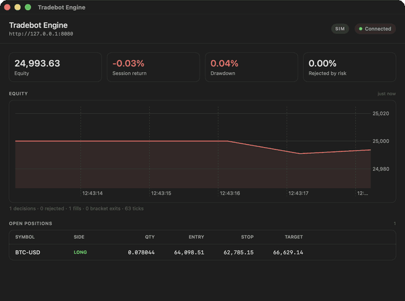
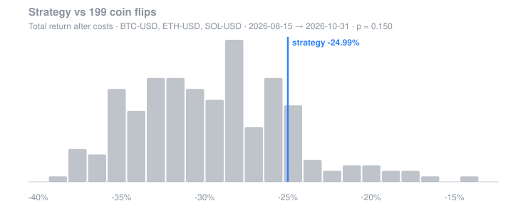
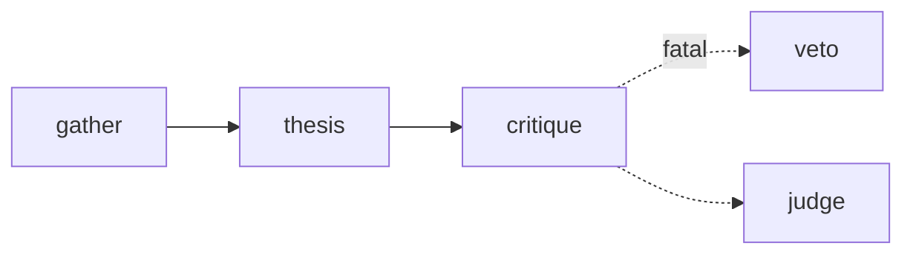
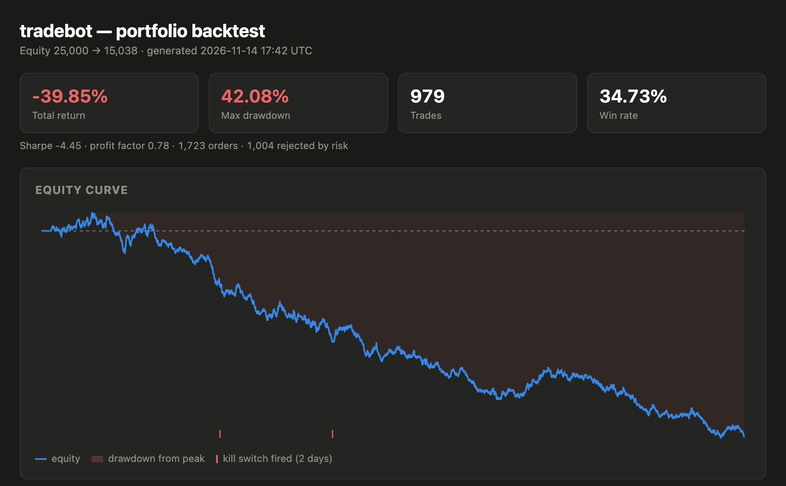

<div align="center">

# tradebot

### A trading system where the AI proposes and a separate risk gate decides.

*Python researches. Go executes. SwiftUI watches. Claude never touches an order directly.*

<br/>

[](https://gkhurana21.github.io/tradebot/)
[](#-try-it-in-one-command)
[](https://gaurangkhurana.ca)

<br/>

[](https://github.com/gkhurana21/tradebot/actions/workflows/ci.yml)


[What it does](#-what-it-does) • [Coin-flip test](#-does-it-beat-a-coin-flip) • [Architecture](#%EF%B8%8F-architecture) • [Design decisions](docs/DESIGN.md) • [Try it](#-try-it-in-one-command)

</div>

> [!WARNING]
> **Not financial advice.** This is a software project, built paper-first. It makes no claim to be profitable,
> and nothing trades real money unless you pass two separate live flags yourself.

> [!NOTE]
> **Status: complete, paper only.** A portfolio project. It is maintained, but not being developed toward live
> trading. The design choices and their trade-offs are written up in [docs/DESIGN.md](docs/DESIGN.md).

---

## The problem

LLMs are good at summarising market context and arguing a case. They are also confidently wrong, and a trading bot that lets
a model place orders is one hallucination away from a blown account. Most "AI trading" projects either trust the
model completely or bolt a few `if` checks onto the same process, where one bug can skip them.

## The fix

**Split thinking from doing, and put a process boundary between them.** Claude reads the market and *proposes*.
A deterministic Go engine sizes, approves or vetoes every proposal, then and only then talks to a broker. A
research-side bug cannot reach the market without passing the gate, because the gate is not in the same program.

<p align="center">
  
</p>
<p align="center"><sub>A real run, sped up 2.5×: the Python strategy (heuristic brain, synthetic prices) proposing
through <code>tradebot live --engine</code>, and the Go gate approving, sizing, blocking and exiting in <b>SIM</b>
mode. Every row in the feed is the engine's own verdict and reason.</sub></p>

<table>
<tr>
<td align="center" width="25%"><h3>105 ns</h3><sub>per risk check in the Go gate, 0 allocations; 0.3 ms per decision from Python over HTTP</sub></td>
<td align="center" width="25%"><h3>$0.27</h3><sub>for a pre-registered test of whether Claude beats a coin flip. It doesn't, and the repo shows why</sub></td>
<td align="center" width="25%"><h3>189</h3><sub>tests in Go and Python, 116 Swift checks, and a CI job that drives Python → Go → Swift end to end</sub></td>
<td align="center" width="25%"><h3>2 flags</h3><sub>needed for real money, so one typo never trades it</sub></td>
</tr>
</table>

## ✨ What it does

<table>
<tr>
<td width="50%"><b>🧠 Two research brains.</b> A single Claude call, or a LangGraph pipeline where one model argues
<i>for</i> the trade, another argues <i>against</i>, and a judge commits. A fatal critique vetoes the trade before
the judge is ever called. A failed critique counts as maximum doubt, never as "no objection".</td>
<td width="50%"><b>🛡️ A risk gate that can say no.</b> Position caps, risk-per-trade, stop-loss, confidence floor,
max open positions and a daily-drawdown kill switch. Rejections are typed values you can count and alert on.
Recovering equity does not clear a halt; only a new session does (the next UTC day in Python, a restart in the Go engine).</td>
</tr>
<tr>
<td><b>📈 Honest backtesting.</b> Backtests share the strategy, brain and risk code with the live loop. Walk-forward
optimization scores parameters out-of-sample. A bar that touches both stop and target resolves as the stop. A real market can gap through a
stop, so simulated results are an upper bound (<a href="docs/DESIGN.md">DESIGN</a> #6).</td>
<td><b>🎲 The "$1 → $1M" reality check.</b> A Monte Carlo of thousands of simulated traders. With a real 55% edge,
careful sizing usually compounds. With the same edge and aggressive sizing, the median trader ends at $0.02.</td>
</tr>
<tr>
<td><b>🔌 Fails closed.</b> Python refuses to drive an engine that isn't in SIM mode. A timeout means
"unknown", never "no trade": the decision is re-sent under the same <code>client_id</code>, which the engine
de-duplicates. An engine restart mid-run stops Python. CI kills the engine mid-run and checks nothing trades after.</td>
<td><b>🤖 Claude can drive it.</b> An MCP bridge lets any Claude session run backtests, sweep a parameter and draw
equity curves, all read-only against the paper broker. A TradingView webhook routes Pine alerts through the same
brain and gate.</td>
</tr>
</table>

## 🎲 Does it beat a coin flip?

A backtest return means little on its own. The real question is whether the strategy beats trading
**the same moments in random directions**. `tradebot nulltest` answers it:

- **Null model.** The same strategy, brain, risk gate, fees, slippage and candles, with one change: each position
  chain, from opening flat to flat again, gets a random sign. The null reverses, stacks and exits exactly when
  the strategy would, so turnover and fees match. Only which way each position faces is left to chance.
- **One primary metric, fixed in advance:** total return after all costs. **p** is the share of 199
  coin-flip runs that did at least as well.
- **Out-of-sample data:** Coinbase hourly bars for BTC, ETH and SOL from 2026-08-15 to 2026-10-31. The strategy code
  last changed on 2026-08-14. The bars are committed in [`docs/data`](docs/data), so anyone gets the same answer.
  The risk engine's kill switch was fixed later (2026-11-14); the result below reproduces exactly at `d0bba99`.

| | Total return | Round trips |
|---|---|---|
| Strategy | **−24.99%** | 624 |
| Coin flips, median of 199 | −29.65% | 633 |
| Coin flips, 5th–95th percentile | −36.20% to −21.37% | |
| **p-value** (one-sided) | **0.150** | |

**Verdict: no evidence of skill.** It lost less than the typical coin flip, but 15% of coin flips did as
well. The tests sanity-check the method rather than measure its power: it flags a planted look-ahead
edge, and on runs with no edge it doesn't report significance more often than it should. Like all backtests,
this uses the Python risk engine; a shared parity test checks it sizes every order exactly as the Go gate does.

<p align="center">
  
</p>

```bash
tradebot nulltest --source snapshot --seeds 199 --svg coinflip.svg   # ~2 minutes, all cores, no API calls
```

### Does *Claude* beat a coin flip? (pre-registered, run once)

The same test with Claude (Haiku 5.5) making every decision. Everything was fixed in
[the pre-registration](docs/claude-test-preregistration.md) before the first paid call: the prompt (account-free, so
all 4,590 prompts were built offline), two co-primary tests at α = 0.025 each, a failure rule and "one run, no
reruns". The whole batch's worst case was computed before sending ($0.51); it actually cost **$0.27**. The data
starts after Haiku 5.5's training cutoff (June 2026). Every answer is committed in
[`docs/claude`](docs/claude) with its sha256 and a per-request spend ledger.

| | Result |
|---|---|
| Valid run? | yes: 23 of 4,590 answers unusable (0.50%; the limit was 2%) |
| Agreement with the strategy's signal | 59.8%; Claude vetoed the other 40.2% and never flipped a direction |
| **(a) Direction:** Claude vs 199 sign-randomised twins | −11.39% vs median −8.03%, **p = 0.805**: no skill |
| **(b) Filtering:** Claude vs 199 random-veto twins at the same 40.2% rate | −11.39% vs median −22.06%, **p = 0.005**: passes α = 0.025 |
| (b) before fees and slippage *(exploratory)* | −1.51% vs median +3.28%, **p = 0.900**: no skill |

**Verdict: no evidence that Claude understands these markets.** Test (b) passed as pre-registered, but the
random-veto twins traded twice as much (473 round trips vs Claude's 238) and paid twice the fees. With costs set to
zero the advantage disappears, so the after-cost win came from Claude *trading less*, not from choosing better
trades. Claude's vetoes cluster in quiet, sideways stretches ("the signal looks like noise"), which cuts turnover.
That can be useful, and it is cheap, but it isn't skill.

The pre-registered p = 0.005 is reported as it came out; the zero-cost check was not pre-registered and is labelled
exploratory. A [replication on fresh data](docs/claude-replication-preregistration.md) (2026-11-15 to 2027-01-15),
pre-registered now with the cost-free test as its primary, will say whether Claude's skips carry any information at
all. The full write-up is in [docs/REPORT.md](docs/REPORT.md).

```bash
tradebot nulltest --brain claude --seeds 199                 # reads the committed answers: free, no key needed
tradebot nulltest --brain claude --seeds 199 --zero-costs    # the exploratory before-costs check
```

## 🏗️ Architecture

```
  Python: research                 Go: execution                Swift: monitoring
  ────────────────                 ─────────────                ─────────────────
  market data ─┐                   ┌──────────────────┐         ┌────────────────┐
  indicators   ├─→ Claude brain ──→│ risk gate  104ns │──fills─→│ equity curve   │
  patterns     │    (proposes) HTTP│ position book    │  HTTP   │ positions      │
  backtests   ─┘                   │ bracket monitor  │────────→│ halt state     │
                                   │ venue sim/alpaca │         └────────────────┘
                                   └──────────────────┘
                                    decides; can say no
```

| Component | Language | What it does |
|---|---|---|
| [research + backtesting](src/tradebot) | Python | strategies, Claude brains, backtester, walk-forward optimizer, Monte Carlo, live paper loop |
| [execution engine](engine) | Go | risk gate, position book, venue seam (sim, Alpaca paper, Alpaca live), HTTP service. Standard library only |
| [dashboard](dashboard) | SwiftUI | native live monitor: equity, positions, halt state, and a SIM / PAPER / LIVE badge so real money is never implied |
| [MCP bridge](mcp) | Python | lets Claude run backtests, sweeps and charts. Read-only |
| [legacy-bot](legacy-bot) | Python | the July 2026 predecessor, kept for its statistical decision gate (below) |

**Which paths go through Go.** `tradebot live --engine URL` sends every decision to the Go gate, which sizes,
approves, fills and exits; Python keeps no book and runs no sizing of its own on that path. Backtests, the
coin-flip test and plain `tradebot live` run the same rules in the Python risk engine, so they work without the
engine running; a shared fixture file checks both engines give the same verdict and size on every case.

**Why the split.** Research is IO-bound and exploratory: it calls an LLM, replays history and tolerates seconds of
latency. Execution is the opposite: fast, deterministic and impossible to bypass by accident. In the engine, one
goroutine owns all state, so there are no locks because there is no shared access. Independent pre-trade controls
are also what regulators require of brokers (SEC Rule 15c3-5); [DESIGN.md](docs/DESIGN.md) has the reasoning.

| Latency | Measured |
|---|---|
| Risk check inside the Go gate (`BenchmarkEvaluate`) | 105 ns, 0 allocations (best of 3, Apple M3) |
| Full engine pipeline incl. channel hop (`BenchmarkPipeline`) | 1.9 µs, 7 allocations |
| Python → Go decision over HTTP, loopback | p50 0.31 ms, p99 2.7 ms (one local run, 176 decisions) |

## ⚡ Try it in one command

```bash
git clone https://github.com/gkhurana21/tradebot.git && cd tradebot
python3 -m venv .venv && source .venv/bin/activate && pip install -e ".[llm]"
./demo.sh
```

The demo runs the whole system end to end: chart analysis on real BTC data, backtests at three risk levels, a
multi-symbol portfolio, walk-forward optimization, the Monte Carlo, a live paper loop and an HTML report. It is free
unless you give it an Anthropic API key, and then only one step calls Claude, capped at 50 Haiku calls (well under a cent).

Run Python through the Go gate and watch it in the dashboard:

```bash
cd engine && go run ./cmd/engine -cash 25000 -profile conservative      # terminal 1: the gate (SIM)
cd dashboard && ./run.sh                                                # terminal 2: the monitor
tradebot live --engine http://127.0.0.1:8080 --source synthetic \
              --symbols BTC-USD --iterations 90 --poll 0.5 --no-llm      # terminal 3: the strategy
```

Run each component's tests:

```bash
cd engine    && go test -race ./...                 # Go: risk gate, book, engine, venue, API, parity
cd dashboard && ./test.sh                           # Swift: decoding, feed, polling, derived metrics
PYTHONPATH=src python3 tests/test_core.py           # Python: strategies, risk, brokers, simulators
```

## 🔧 Under the hood

<details>
<summary><b>CLI, brains, risk, the Go engine, the MCP bridge, legacy-bot and testing in detail</b></summary>

### The CLI

Everything is one `tradebot` command (or `PYTHONPATH=src python3 -m tradebot` with no install; the core needs only
the standard library):

```bash
tradebot analyze --source coinbase --symbol BTC-USD   # read the chart: trend, S/R, patterns
tradebot backtest --symbol BTC-USD --profile balanced --verbose
tradebot compare --symbol BTC-USD                     # free heuristic vs Claude, side by side
tradebot portfolio --onchain                          # 3-symbol ensemble + on-chain context
tradebot optimize --bars 2000 --folds 4               # walk-forward parameter search
tradebot live --iterations 400 --poll 0               # live paper loop (streams JSON events)
tradebot live --engine http://127.0.0.1:8080 ...      # same loop, every decision through the Go gate
tradebot webhook --secret YOURSECRET                  # TradingView alert receiver
tradebot dashboard --out dashboard.html               # HTML report
tradebot breakeven                                    # win rate needed to beat fees
tradebot montecarlo                                   # risk-of-ruin simulator
tradebot nulltest --source snapshot                   # does it beat a coin flip?
tradebot snapshot --start 2026-08-15 --end 2026-11-01 # save a fixed Coinbase window
tradebot onchain                                      # live on-chain snapshot
```

### Two research brains

```bash
tradebot backtest --brain single    # one Claude call (default)
tradebot backtest --brain graph     # LangGraph: thesis -> critique -> judge
```

A single pass has no way to catch its own motivated reasoning: a model handed a bullish signal tends to find bullish
reasons. `--brain graph` makes one stage adversarial:



| Node | Role | Cost |
|---|---|---|
| `gather` | deterministic feature extraction, incl. cost drag | free |
| `thesis` | argues **for** the trade | 1 call |
| `critique` | argues **against** it, and only against it | 1 call |
| `judge` | weighs both and commits | 1 call |
| `veto` | terminal, when the critique is fatal | free |

Rejections are the common case, so it usually costs **2 calls, not 3**. The final rationale carries both sides, so
a losing trade is reviewable later. Both brains return the same `Decision`, so nothing downstream changes. Install
with `pip install -e ".[graph]"`. It costs 2–3x a single call and there is no evidence yet that it trades better;
that is what `compare` is for.

The brain can also be **news-aware** (`Brain(news_aware=True)`): Claude web-searches headlines before deciding.

### Cost controls

Each signal is one Claude API call, so spend is capped:

- `--model opus|sonnet|haiku`: Haiku 5.5 costs roughly $0.0001 a call (at most $0.0002 with the 200-token
  reply cap); Opus 5.5 costs about 40× that.
- `--max-llm-calls N`: after N calls the run finishes on the free heuristic.
- Every LLM run prints its actual spend: `LLM calls: 34  tokens in/out: … est. spend: $0.24`.

### Risk profiles, read honestly

`--profile conservative|balanced|aggressive` uses the same signals at three risk levels. On identical data,
aggressive turned a **-2.8%** result into **-10.5%** with a 13.8% drawdown. **Aggressive raises the risk of ruin; it
does not raise expected return.** A -90% loss needs +900% to recover.

### The "$1 → $1M" question

| Assumed edge | Sizing | Result |
|---|---|---|
| 50% (no edge) | careful 5% | ~0% reach $1M, bleed toward $0 |
| 51% (thin edge) | careful 5% | ~0% reach $1M |
| 55% @1:1 net of fees | careful 5% | ~87–92% reach $1M, but over ~3,700 trades (years) |
| 55% edge | **aggressive 50%** | median ends at **$0.02**: overbetting ruins you *with* an edge |

**Compounding isn't the hard part; a durable edge is.** The backtester, walk-forward optimizer and analysis engine
exist to hunt for one honestly.

### The Go engine

| Benchmark | Latency | Allocations |
|---|---|---|
| Risk gate (`Evaluate`) | **105 ns/op** | **0 B, 0 allocs** |
| Risk gate, parallel | 121 ns/op | 0 B, 0 allocs |
| Full pipeline (incl. channel hop) | 1.9 µs/op | 1,106 B, 7 allocs |

```bash
go run ./cmd/engine -venue sim            # default: simulated fills, no account
go run ./cmd/engine -venue alpaca-paper   # real order lifecycle, no money
go run ./cmd/engine -venue alpaca-live -i-understand-this-trades-real-money
```

Best of three runs on an Apple M3. Market data is dropped when the buffer is full (a stale price is worse than a
missing one); a caller that needs the price applied first uses `POST /tick?wait=1`, which answers 503 instead. A failed close never
updates the book, so risk never believes a position is flat while the broker still holds it. The Alpaca wire format
is tested against a stubbed transport but has not been smoke-tested against a live account. Full design notes are in
[engine/README.md](engine/README.md).

### The HTML report

<p align="center">
  
</p>

`tradebot dashboard` writes a self-contained report (also published as the [live demo](https://gkhurana21.github.io/tradebot/)).
On synthetic data the default strategy loses 40% over 979 trades after fees; the shading is drawdown from peak and
the red ticks are the two days the kill switch fired. The kill switch caps a bad day; it cannot create an edge.

### The MCP bridge

`backtest_run`, `backtest_sweep`, `backtest_chart` and `market_quote`, over stdio with no SDK. Deterministic by
default (heuristic brain, fixed seed) so a sweep compares parameters, not LLM noise. `market_quote` reads from
[QuantCore](https://github.com/gkhurana21/quantcore)'s Go proxy. See [mcp/README.md](mcp/README.md).

### Chart patterns and integrations

`core/patterns.py` reads a candle window the way a trader would: trend and strength (regression + ADX),
support/resistance from clustered swing pivots, candlestick patterns and range breakouts or double tops/bottoms.
On-chain signals (gas, stablecoin supply) come from public RPC. A TradingView alert pointed at
`http://<host>:8787/webhook` is authenticated by shared secret and routed through the same brain and risk engine,
so an alert still can't move money on its own.

### legacy-bot

The first version, from July 2026: time-series and cross-sectional momentum, mean reversion and a **null-random
control** that trades random directions through the same costs and execution path. Its decision gate compares each
strategy against that control (a two-proportion z-test, falling back to Fisher's exact test on small samples) and
only calls a strategy a candidate when it beats random at significance. It has its own no-lookahead tests. Live
trading was never built there.

### Testing

| Suite | Command | Count |
|---|---|---|
| Go | `cd engine && go test -race ./...` | 87 tests + 3 benchmarks |
| Python | `tests/test_core.py`, `test_graph.py`, `test_nulltest.py`, `test_claudetest.py`, `test_bridge.py`, `test_risk_parity.py` | 28 + 13 + 8 + 29 + 23 + 1 (27 shared fixtures) |
| Swift | `cd dashboard && ./test.sh` | 116 checks in 24 suites |

CI runs all three on every push, plus two cross-language jobs. The **bridge** job starts the Go engine, runs the
Python strategy against it for 300 bars, and checks Python's record against the engine's own: every decision, every
fill (flips as two legs) and every exit. The Swift client reads the same numbers, then the engine is killed mid-run
and Python must stop with exit code 2 and no further trades.

### Layout

| Path | Role |
|------|------|
| `src/tradebot/core/` | types, strategies (EMA/RSI, Bollinger, ensemble), risk engine, metrics, patterns |
| `src/tradebot/brain/` | single-call brain and LangGraph research graph |
| `src/tradebot/brokers/` | broker interface and paper broker (fees, slippage) |
| `src/tradebot/backtest/` | single-symbol and portfolio backtesters, walk-forward optimizer, HTML report |
| `src/tradebot/live/` | live loop, the Python/Go gate seam (`gate.py`) and TradingView webhook |
| `src/tradebot/sim/` | Monte Carlo, break-even, coin-flip test, and the Claude coin-flip harness |
| `src/tradebot/data/` | synthetic, Coinbase and CSV feeds; on-chain signals |
| `engine/` | Go execution engine |
| `dashboard/` | SwiftUI monitor |
| `mcp/` | MCP bridge |
| `legacy-bot/` | July 2026 predecessor |
| `docs/data/` | the committed Coinbase snapshot behind the coin-flip result |
| `docs/DESIGN.md` | design decisions and their trade-offs |
| `docs/REPORT.md` | research note: does an LLM add trading skill? |
| `docs/claude-test-preregistration.md` | the frozen plan for the Claude coin-flip test |
| `docs/claude/` | every Claude answer from that test, its sha256 and the per-request spend ledger |
| `docs/claude-replication-preregistration.md` | the frozen plan for the fresh-data replication |
| `tests/fixtures/risk_parity.json` | cases both risk engines must agree on |
| `docs/tools/` | a scripted demo driver for the dashboard |

</details>

## What this does not do

It does not claim to be profitable. The simulated venue fills instantly at the mark, with no order book, queue
position or partial fills; that is what Alpaca paper mode exists to replace. Whether a retail trader can find a
durable edge on public data is an open question this repo is built to test, not one it pretends to have answered.

## License

MIT. See [LICENSE](LICENSE).
