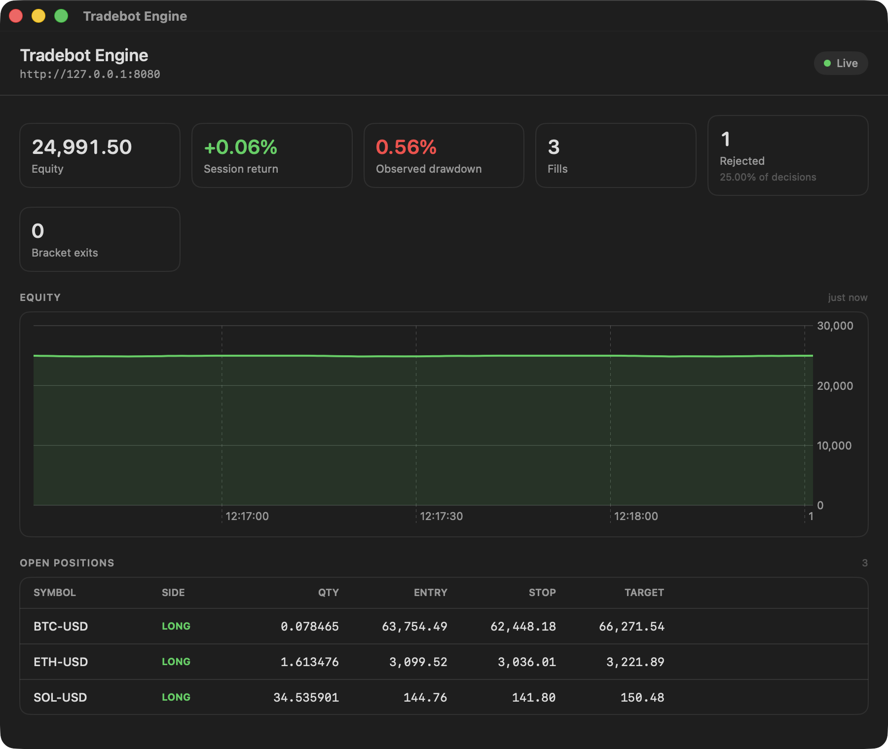
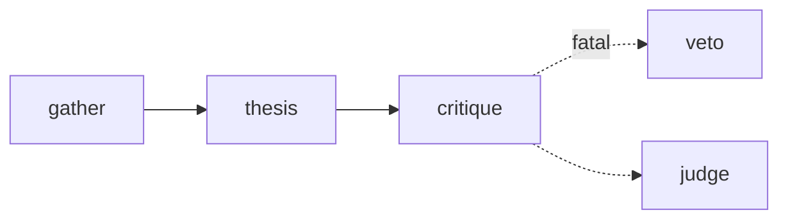

<div align="center">

# tradebot

### A trading system where the AI proposes and a 104-nanosecond risk gate decides.

*Python researches. Go executes. SwiftUI watches. Claude never touches an order directly.*

<br/>

[](#-try-it-in-one-command)
[](https://gaurangkhurana.ca)

<br/>

[](https://github.com/gkhurana21/tradebot/actions/workflows/ci.yml)


[What it does](#-what-it-does) • [Architecture](#-architecture) • [Try it](#-try-it-in-one-command) • [Under the hood](#-under-the-hood)

</div>

> [!WARNING]
> **Not financial advice.** This is a software project, built paper-first. It makes no claim to be profitable,
> and nothing trades real money unless you pass two separate live flags yourself.

> [!NOTE]
> **Status: finished and frozen.** This was my showcase trading system. My active research has moved on; the
> code here stays as a complete, tested reference.

---

## The problem

LLMs are good at reading a chart and arguing a case. They are also confidently wrong, and a trading bot that lets
a model place orders is one hallucination away from a blown account. Most "AI trading" projects either trust the
model completely or bolt a few `if` checks onto the same process, where one bug can skip them.

## The fix

**Split thinking from doing, and put a process boundary between them.** Claude reads the market and *proposes*.
A deterministic Go engine sizes, approves or vetoes every proposal, then and only then talks to a broker. A
research-side bug cannot reach the market without passing the gate, because the gate is not in the same program.

<table>
<tr>
<td align="center" width="25%"><h3>104 ns</h3><sub>per risk-gate check, 0 allocations, race-tested</sub></td>
<td align="center" width="25%"><h3>3</h3><sub>languages, each doing the job it is best at</sub></td>
<td align="center" width="25%"><h3>109</h3><sub>tests across Go, Python and Swift, plus a cross-language CI job</sub></td>
<td align="center" width="25%"><h3>2 flags</h3><sub>needed for real money, so one typo never trades it</sub></td>
</tr>
</table>

<table>
<tr>
<td width="50%"><br/><b>The native monitor.</b> The SwiftUI dashboard watching the Go engine in sim mode: three positions with
their stops and targets, and one proposal the gate rejected for low confidence.</td>
<td width="50%"><br/><b>The kill switch, working.</b> A losing three-symbol backtest. Once equity fell 5% below where it started,
the gate halted trading and nothing traded again. That flat line is the feature.</td>
</tr>
</table>

## ✨ What it does

<table>
<tr>
<td width="50%"><b>🧠 Two research brains.</b> A single Claude call, or a LangGraph pipeline where one model argues
<i>for</i> the trade, another argues <i>against</i>, and a judge commits. A fatal critique vetoes the trade before
the judge is ever called. A failed critique counts as maximum doubt, never as "no objection".</td>
<td width="50%"><b>🛡️ A risk gate that can say no.</b> Position caps, risk-per-trade, stop-loss, confidence floor,
max open positions and a daily-drawdown kill switch. Rejections are typed values you can count and alert on.
Recovering equity does not clear a halt; only a new session does.</td>
</tr>
<tr>
<td><b>📈 Honest backtesting.</b> The backtest runs the exact code path a live run would. Walk-forward optimization
scores parameters out-of-sample. A bar that touches both stop and target resolves as the stop, because assuming the
favorable fill would inflate every result.</td>
<td><b>🎲 The "$1 → $1M" reality check.</b> A Monte Carlo of thousands of simulated traders. With a real 55% edge,
careful sizing usually compounds. With the same edge and aggressive sizing, the median trader ends at $0.02.</td>
</tr>
<tr>
<td><b>🔌 Real broker, behind the gate.</b> An Alpaca venue with paper and live modes: env-only credentials,
reconciliation on startup, idempotency keys on every order, no retries on 4xx, and venue limits enforced before an
order is sent.</td>
<td><b>🤖 Claude can drive it.</b> An MCP bridge lets any Claude session run backtests, sweep a parameter and draw
equity curves, all read-only against the paper broker. A TradingView webhook routes Pine alerts through the same
brain and gate.</td>
</tr>
</table>

## 🏗️ Architecture

```
  Python: research                 Go: execution                Swift: monitoring
  ────────────────                 ─────────────                ─────────────────
  market data ─┐                   ┌──────────────────┐         ┌────────────────┐
  indicators   ├─→ Claude brain ──→│ risk gate  104ns │──fills─→│ equity curve   │
  patterns     │    (proposes) HTTP│ position book    │  HTTP   │ positions      │
  backtests   ─┘                   │ bracket monitor  │────────→│ halt state     │
                                   │ venue sim/alpaca │         └────────────────┘
                                   └──────────────────┘
                                    decides; can say no
```

| Component | Language | What it does |
|---|---|---|
| [research + backtesting](src/tradebot) | Python | strategies, Claude brains, backtester, walk-forward optimizer, Monte Carlo, live paper loop |
| [execution engine](engine) | Go | risk gate, position book, venue seam (sim, Alpaca paper, Alpaca live), HTTP service. Standard library only |
| [dashboard](dashboard) | SwiftUI | native live monitor: equity curve, positions, halt state |
| [MCP bridge](mcp) | Python | lets Claude run backtests, sweeps and charts. Read-only |
| [legacy-bot](legacy-bot) | Python | the July 2026 predecessor, kept for its statistical decision gate (below) |

**Why the split.** Research is IO-bound and exploratory: it calls an LLM, replays history and tolerates seconds of
latency. Execution is the opposite: fast, deterministic and impossible to bypass by accident. In the engine, one
goroutine owns all state, so there are no locks because there is no shared access.

## ⚡ Try it in one command

```bash
git clone https://github.com/gkhurana21/tradebot.git && cd tradebot
python3 -m venv .venv && source .venv/bin/activate && pip install -e ".[llm]"
./demo.sh
```

The demo runs the whole system end to end: chart analysis on real BTC data, backtests at three risk levels, a
multi-symbol portfolio, walk-forward optimization, the Monte Carlo, a live paper loop and an HTML report. It is free
unless you give it an Anthropic API key, and then only one step calls Claude, capped at 50 Haiku calls (about 3 cents).

Run each component's tests:

```bash
cd engine    && go test -race ./...                 # Go: risk gate, book, engine, venue
cd dashboard && ./test.sh                           # Swift: decoding, polling, derived metrics
PYTHONPATH=src python3 tests/test_core.py           # Python: strategies, risk, brokers, simulators
```

## 🔧 Under the hood

<details>
<summary><b>CLI, brains, risk, the Go engine, the MCP bridge, legacy-bot and testing in detail</b></summary>

### The CLI

Everything is one `tradebot` command (or `PYTHONPATH=src python3 -m tradebot` with no install; the core needs only
the standard library):

```bash
tradebot analyze --source coinbase --symbol BTC-USD   # read the chart: trend, S/R, patterns
tradebot backtest --symbol BTC-USD --profile balanced --verbose
tradebot compare --symbol BTC-USD                     # free heuristic vs Claude, side by side
tradebot portfolio --onchain                          # 3-symbol ensemble + on-chain context
tradebot optimize --bars 2000 --folds 4               # walk-forward parameter search
tradebot live --iterations 400 --poll 0               # live paper loop (streams JSON events)
tradebot webhook --secret YOURSECRET                  # TradingView alert receiver
tradebot dashboard --out dashboard.html               # HTML report
tradebot breakeven                                    # win rate needed to beat fees
tradebot montecarlo                                   # risk-of-ruin simulator
tradebot onchain                                      # live on-chain snapshot
```

### Two research brains

```bash
tradebot backtest --brain single    # one Claude call (default)
tradebot backtest --brain graph     # LangGraph: thesis -> critique -> judge
```

A single pass has no way to catch its own motivated reasoning: a model handed a bullish signal tends to find bullish
reasons. `--brain graph` makes one stage adversarial:



| Node | Role | Cost |
|---|---|---|
| `gather` | deterministic feature extraction, incl. cost drag | free |
| `thesis` | argues **for** the trade | 1 call |
| `critique` | argues **against** it, and only against it | 1 call |
| `judge` | weighs both and commits | 1 call |
| `veto` | terminal, when the critique is fatal | free |

Rejections are the common case, so it usually costs **2 calls, not 3**. The final rationale carries both sides, so
a losing trade is reviewable later. Both brains return the same `Decision`, so nothing downstream changes. Install
with `pip install -e ".[graph]"`. It costs 2–3x a single call and there is no evidence yet that it trades better;
that is what `compare` is for.

The brain can also be **news-aware** (`Brain(news_aware=True)`): Claude web-searches headlines before deciding.

### Cost controls

Each signal is one Claude API call, so spend is capped:

- `--model opus|sonnet|haiku`: Haiku is about $0.0015 a call against Opus at about $0.007.
- `--max-llm-calls N`: after N calls the run finishes on the free heuristic.
- Every LLM run prints its actual spend: `LLM calls: 34  tokens in/out: … est. spend: $0.24`.

### Risk profiles, read honestly

`--profile conservative|balanced|aggressive` uses the same signals at three risk levels. On identical data,
aggressive turned a **-2.8%** result into **-10.5%** with a 13.8% drawdown. **Aggressive raises the risk of ruin; it
does not raise expected return.** A -90% loss needs +900% to recover.

### The "$1 → $1M" question

| Assumed edge | Sizing | Result |
|---|---|---|
| 50% (no edge) | careful 5% | ~0% reach $1M, bleed toward $0 |
| 51% (thin edge) | careful 5% | ~0% reach $1M |
| 55% @1:1 net of fees | careful 5% | ~87–92% reach $1M, but over ~3,700 trades (years) |
| 55% edge | **aggressive 50%** | median ends at **$0.02**: overbetting ruins you *with* an edge |

**Compounding isn't the hard part; a durable edge is.** The backtester, walk-forward optimizer and analysis engine
exist to hunt for one honestly.

### The Go engine

| Benchmark | Latency | Allocations |
|---|---|---|
| Risk gate (`Evaluate`) | **104 ns/op** | **0 B, 0 allocs** |
| Risk gate, parallel | 122 ns/op | 0 B, 0 allocs |
| Full pipeline (incl. channel hop) | 1.66 µs/op | 864 B, 4 allocs |

```bash
go run ./cmd/engine -venue sim            # default: simulated fills, no account
go run ./cmd/engine -venue alpaca-paper   # real order lifecycle, no money
go run ./cmd/engine -venue alpaca-live -i-understand-this-trades-real-money
```

Market data is dropped when the buffer is full (a stale price is worse than a missing one), and a failed close never
updates the book, so risk never believes a position is flat while the broker still holds it. The Alpaca wire format
is tested against a stubbed transport but has not been smoke-tested against a live account. Full design notes are in
[engine/README.md](engine/README.md).

### The MCP bridge

`backtest_run`, `backtest_sweep`, `backtest_chart` and `market_quote`, over stdio with no SDK. Deterministic by
default (heuristic brain, fixed seed) so a sweep compares parameters, not LLM noise. `market_quote` reads from
[QuantCore](https://github.com/gkhurana21/quantcore)'s Go proxy. See [mcp/README.md](mcp/README.md).

### Chart patterns and integrations

`core/patterns.py` reads a candle window the way a trader would: trend and strength (regression + ADX),
support/resistance from clustered swing pivots, candlestick patterns and range breakouts or double tops/bottoms.
On-chain signals (gas, stablecoin supply) come from public RPC. A TradingView alert pointed at
`http://<host>:8787/webhook` is authenticated by shared secret and routed through the same brain and risk engine,
so an alert still can't move money on its own.

### legacy-bot

The first version, from July 2026: time-series and cross-sectional momentum, mean reversion and a **null-random
control** that trades random directions through the same costs and execution path. Its decision gate compares each
strategy against that control (a two-proportion z-test, falling back to Fisher's exact test on small samples) and
only calls a strategy a candidate when it beats random at significance. It has its own no-lookahead tests. Live
trading was never built there.

### Testing

| Suite | Command | Count |
|---|---|---|
| Go | `cd engine && go test -race ./...` | 45 tests + 3 benchmarks |
| Python | `tests/test_core.py`, `tests/test_graph.py` | 20 + 13 tests |
| Swift | `cd dashboard && ./test.sh` | 31 checks |

CI runs all three on every push, plus an **integration job** that starts the Go engine, drives a trade through the
risk gate and probes it with the Swift client: the cross-language seam unit tests cannot cover.

### Layout

| Path | Role |
|------|------|
| `src/tradebot/core/` | types, strategies (EMA/RSI, Bollinger, ensemble), risk engine, metrics, patterns |
| `src/tradebot/brain/` | single-call brain and LangGraph research graph |
| `src/tradebot/brokers/` | broker interface and paper broker (fees, slippage) |
| `src/tradebot/backtest/` | single-symbol and portfolio backtesters, walk-forward optimizer, HTML report |
| `src/tradebot/live/` | live paper loop and TradingView webhook |
| `src/tradebot/sim/` | Monte Carlo and break-even simulators |
| `src/tradebot/data/` | synthetic, Coinbase and CSV feeds; on-chain signals |
| `engine/` | Go execution engine |
| `dashboard/` | SwiftUI monitor |
| `mcp/` | MCP bridge |
| `legacy-bot/` | July 2026 predecessor |

</details>

## What this does not do

It does not claim to be profitable. The simulated venue fills instantly at the mark, with no order book, queue
position or partial fills; that is what Alpaca paper mode exists to replace. Whether a retail trader can find a
durable edge on public data is an open question this repo is built to test, not one it pretends to have answered.

## License

MIT. See [LICENSE](LICENSE).
